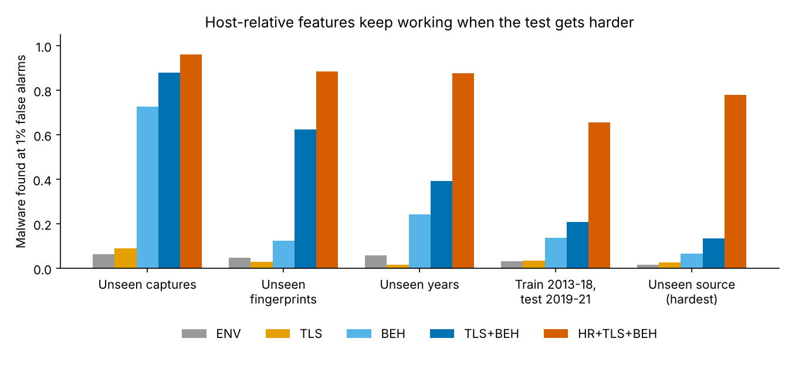

# ja4next — Detecting the Lab, Not the Malware

Code, manifests and results for a leakage-controlled study of JA4/TLS-fingerprint malware detection, and for a new
**host-relative** feature family that describes every TLS connection *relative to the same computer's own traffic*.

> **Status: exploratory.** Every number below comes from a file in `results/` and was computed on data we had already
> looked at. The pre-registered confirmatory test on malware-traffic-analysis.net 2022–2026 has **not** been run
> (see [docs/PREREG_ADDENDUM.md](docs/PREREG_ADDENDUM.md); it needs the guide's sign-off first).

**New to the project? Read [docs/ja4next_project_summary.pdf](docs/ja4next_project_summary.pdf)** — a plain-language walk-through.

## The idea in three lines
1. Many published JA4 malware detectors score 98–99%, but malware and benign traffic usually come from *different places*,
   so the model can learn the place (the lab) instead of the malware.
2. We test on recordings where malware and normal traffic share one infected computer, and on a second, independent lab.
3. On our main data, host-relative features (destination rarity, repetition, size relative to the host, stack share) keep working when
   the test gets harder, where fingerprint+behaviour models collapse. The second lab confirms low false alarms on clean traffic but **not** a detection gain.

## Headline results (exploratory; `results/hostname_only/summary.csv`)
Malware found at 1% false alarms, connections with a hostname, MTA 2013–2021:

| Test | TLS+BEH (old best) | HR+TLS+BEH (host-relative) |
|---|---|---|
| Unseen captures | 0.88 | 0.96 |
| Unseen fingerprints | 0.62 | 0.89 |
| Unseen years | 0.39 | 0.88 |
| Unseen source (hardest) | 0.14 | 0.78 |



* **False alarms on clean traffic from another lab** (Stratosphere CTU-Normal, 17 captures; threshold set at 1% on the training lab):
  TCP/IP-only model flags 76% of connections, TLS+BEH 1.7%, host-relative 0.0% (`results/foreign_benign/`). Easy traffic (scripted browsing): false-alarm result only.
* **Second-lab detection is NOT confirmed.** Strict labels (8 malware captures): TLS+BEH AUC 0.95, host-relative 0.95 (no reliable gain); broad labels: 0.62 vs 0.68. An earlier 6-capture run looked far better and did not survive two more captures. Report both labelings (`results/second_lab*/`, [docs/SECOND_LAB.md](docs/SECOND_LAB.md)).
* **What replicates across labs:** of 31 single features that separate classes clearly in both labs, 30 point the same way (destination-context features lead; `results/second_lab/feature_direction.csv`).
* **Incident grouping** (idea from the concurrent SCBD-R project) lowers false alerts only ~1.7x on this data (`results/incidents/`).
* The earlier Matoušek-corpus audit (environment-only model 0.986; MSS 1357 marks 93% of 2024 sandbox malware) is in the project record, not recomputed by this repo.

## Limitations (read before citing)
* Exploratory only; confirmatory run pending. Labels are indirect (analyst IOCs, SSLBL/Feodo/Maltrail, vendor allowlist), not ground truth.
* Second-lab strict malware labels cover very few captures; results change with the labelling rule.
* Mimicry is not tested with a live deliberately-disguised client; no real ECH traffic; not yet reproduced on the team Mac.
* Hostname-only analysis discards most botnet connections (95% of the Stratosphere botnet set has no SNI).

## Data (not redistributed; manifests list public URLs and SHA-256)
| Source | Use | Count |
|---|---|---|
| malware-traffic-analysis.net 2013–2021 | main training/evaluation | 88,085 TLS connections from 1,052 captures (`results/dataset_summary.json`) |
| Stratosphere MCFP botnet / Mixed / Normal / targeted trojans | second lab, clean-benign test | 1,233,256 TLS connections from 160 captures (`results/data_quality.json`) |
| malware-traffic-analysis.net 2022–2026 | **locked confirmatory holdout** | never downloaded |
| TQH-C2, CTU-SME-11 | reserved confirmatory sets | README/labels only; no model touches them |

Data-quality audit (duplicates, missing values, malformed fingerprints): `python3 -I scripts/data_quality.py` → `results/data_quality.json`.

## Setup
```bash
python3 -m venv .venv && .venv/bin/pip install -r requirements.txt      # also needs tshark >= 4.2 (apt/brew install tshark)
python3 -m pytest -q tests                                                # 13 unit tests
git clone --depth 1 https://github.com/FoxIO-LLC/ja4 /tmp/ja4 && python3 -I tests/validate_foxio.py /tmp/ja4   # JA4 150/151, JA4S 85/85
```

## Run
```bash
scripts/run_all.sh                 # env check, labels, MTA crawl+download+extract+label, evaluation, Stratosphere stage, figures
scripts/run_stage.sh evaluate      # one stage at a time (idempotent; state in state/, logs in logs/)
scripts/run_stratosphere.sh        # second-lab stage only (resume-safe downloads, ~45 GB transferred, ~10 GB peak disk)
python3 scripts/make_figures.py && python3 scripts/make_summary_pdf.py
```
The main evaluation reproduces bit-for-bit (`max |difference| = 0` over all 50 summary rows on a fresh rerun with the same seeds).

## Layout
`src/ja4next/` extractor (`extract.py`), labels (`labels.py`), features (`features.py`), evaluation (`evaluate.py`), Stratosphere crawler/README parser
(`crawl_mcfp.py`, `strat.py`), second lab (`second_lab.py`), clean-benign test (`foreign_benign.py`), incidents (`incidents.py`), locked confirmatory run (`confirm.py`).
`scripts/` stage runners, fetchers, audits, figures, PDF. `results/` every reported number. `docs/` datasets, novelty, threat model, pre-registration addendum, second-lab findings, figures, PDF. `tests/` unit tests and FoxIO validation.

## Safety and ethics
Only public pcaps and indicator text are fetched. Never downloads sample/binary zips (names containing "malware"), never executes anything from `data/`, never visits IOC hosts.
The 2022–2026 holdout is refused by the downloader and by the `confirm` stage until `docs/PREREG_FROZEN.sha256` exists (created only by a human after sign-off).
Sandbox data (Tria.ge) terms may restrict ML use; raise with supervisors before publishing derived data.
